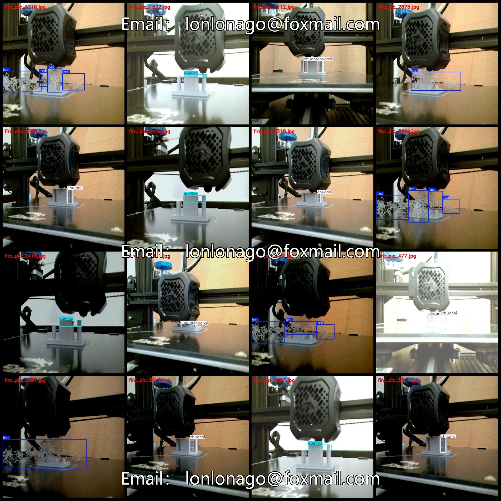
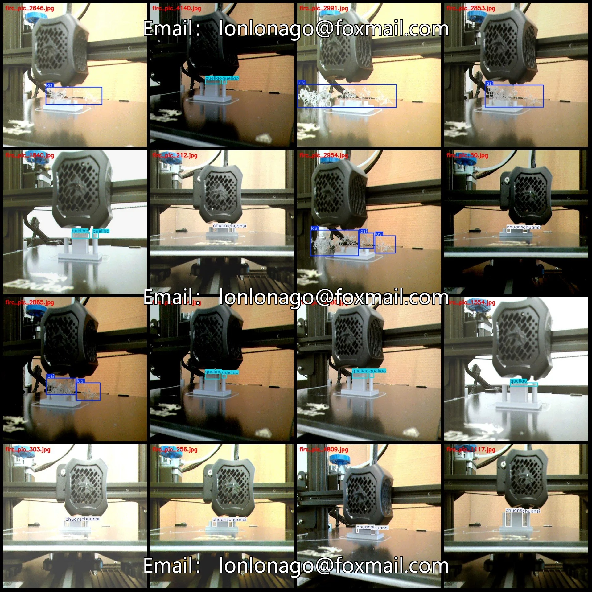
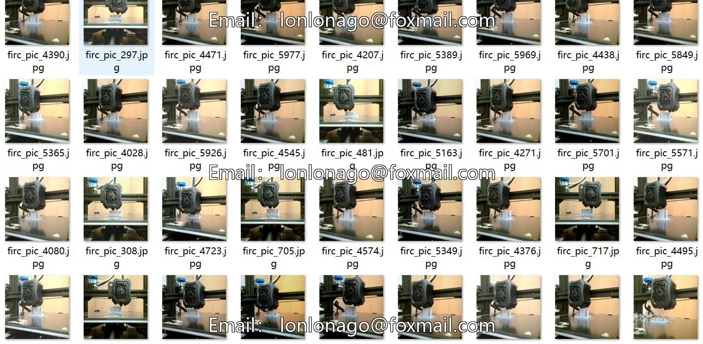
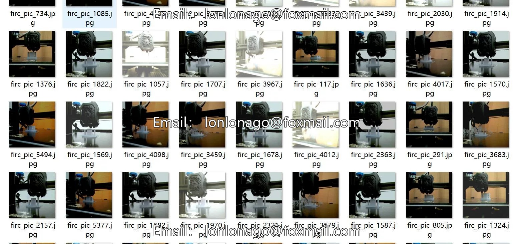

# 3D printing anomaly detection dataset VOC+YOLO format with 6053 images in 3 categories

## Body

3D Printing Abnormality Detection Dataset VOC+YOLO format: 6053 images in 3 categories
Tips: Due to the dataset's replicability, please confirm compliance before purchasing.
Dataset format: Pascal VOC format + YOLO format (txt files without split paths, only containing jpg images and corresponding VOC format xml files and yolo format txt files)
Number of images (number of jpg files): 6053
Number of annotations (number of xml files): 6053
Number of annotations (number of txt files): 6053
Number of annotation categories: 3

Label category names (Note that the order of categories in the YOLO format does not correspond to this, but is based on the labels folder's classes.txt): ["chuansi", "lasi", "queliao"]
["Stringing (extruding fine threads that cause a filament-like substance on the model surface during print head movement)", "Spinning (extruding excess material in the form of thin threads, resembling spaghetti during printing)", "Defective Material (excessive material extruded that results in gaps or missing layers)"]
Number of boxes labeled in each category
Chunsi Frame Count = 4479
Number of Lasi boxes = 2235
Queliao Frames = 3107
Total frame count: 9821
Number of images per category

Chuansi occupies 2867 images
Lasi occupies 1248 images
Queliao occupies 1938 images
Image resolution: 640x640
Labeling tool used: labelImg
Labeling rules: Draw a rectangle around the category.
Important note: The dataset does not have separate training, validation, and test sets; you need to partition them yourself.
Special declaration: This dataset does not guarantee the accuracy of the trained models or weight files.

## Images

## Payment

Here is a pay link on Stripe ( https://buy.stripe.com/3cs8yP7sY87d0vu9AB ). Please contact me lonlonago@foxmail.com after funding $89, and I will send you a complete data files , thank you!

